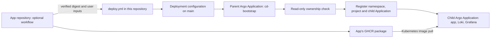

# ARGO-CD-GitOPS-Deployments

A shared deployment repository for applications running on minikube. Each app
builds and publishes its image to GHCR; this repository stores the deployment
settings that Argo CD applies to the cluster.



Each installation has its own namespace, Argo Application, Loki and Grafana.
A parent Application registers new installations automatically.

## Setup

You need Python 3, Docker Desktop, minikube, kubectl and an existing Argo CD
installation in the `argocd` namespace. Commands below run from this repository
in your Mac terminal, with Docker Desktop and minikube running.

Configure GitHub access:

| Where | Setting |
|---|---|
| App repository | Add the Actions repository secret `CD_DISPATCH_TOKEN` |
| Token permissions | Grant **Actions: read and write** on `ARGO-CD-GitOPS-Deployments` |
| App's GHCR package | Set visibility to **Public**; publish ARM64 and AMD64 images |
| Deployment repository | Allow its workflow to push generated configuration to `main` |

Keep tokens and cluster credentials out of Git. Restrict write access to trusted
maintainers, because this repository controls Argo Applications and Projects.

## Connect Argo once per cluster

Preview the parent configuration:

```bash
python3 scripts/parent.py > /tmp/argo-cd-parent.json
cat /tmp/argo-cd-parent.json
```

Then install it:

```bash
python3 scripts/parent.py --install
kubectl --context minikube -n argocd get application cd-bootstrap
```

The parent watches `bootstrap/` on `main`. Before registering an installation,
a read-only check verifies resource ownership; conflicts stop registration.
Resources belonging to other installations are not adopted, and automatic
deletion is disabled.

Run the installer again when updating the installed ownership-check code or
permissions. Ordinary deployments do not need another install or manual apply.

## Deploy an app

1. Open the app repository's optional workflow in **GitHub Actions**.
2. Select **Deploy: Yes**. Select **Build image: Yes** for a new build, or
   **Build image: No** and supply an existing image reference:

   ```text
   ghcr.io/<owner>/<image>@sha256:<digest>
   ```

3. Enter the namespace, deployment name and three unused local ports. Keep the
   same namespace and deployment name when updating an existing installation.
4. Follow **Actions → Record deployment request** in this repository. It checks
   the inputs and public image, then saves the generated configuration.
5. Argo registers the installation and deploys the app, Loki and Grafana.
   The run summary provides the deployment ID and access commands.

Namespace and deployment names must contain **1–63 lowercase letters, digits
or hyphens**, and start and end with a letter or digit. Use `demo-1`;
`demo_1`, uppercase letters and spaces are invalid.

Each installation needs its own namespace and distinct local ports. System and
protected namespaces are rejected, along with reserved local ports `18080`,
`18081`, `18082`, `3000` and `3100`.

| Component | Default local port |
|---|---|
| App | `18090` |
| Grafana | `3001` |
| Loki | `3101` |

## Check and access the deployment

Use the exact commands from the workflow summary or the installation's
`commands.txt`. Check that its Argo Application is **Synced/Healthy** and its
Pods are ready, then start each port-forward in a separate terminal.

With the default local ports, open the app at **http://127.0.0.1:18090** and
Grafana at **http://127.0.0.1:3001/d/cd-requests**. If the app sends request logs
to Loki, match a request ID from the app with its Grafana row.

A successful workflow means the configuration was saved. Check the child
Application and app response to confirm that deployment finished.

## Add another app

Create `projects/<project>.json` with that app's settings, for example:

```json
{
  "source_repository": "your-account/your-app",
  "container_port": 8081,
  "health_path": "/healthz",
  "environments": ["development"],
  "environment": {}
}
```

The image must support the configured listener and health endpoint. The app
provides its own log shipping; this repository does not add application code.
Its publishing workflow must send the inputs declared in
[deploy.yml](.github/workflows/deploy.yml), including the project name, source
commit, image digest, environment and destination settings.

Generated files are stored in:

```text
projects/                                      App profiles
deployments/<project>/<namespace>/<deployment>/ App settings and access commands
bootstrap/                                     Argo registration files
scripts/                                       Setup, rendering and ownership checks
tests/                                         Local checks
```

## Troubleshooting

| Problem | Check |
|---|---|
| Missing `CD_DISPATCH_TOKEN` | Store the secret in the **app repository** |
| Invalid namespace or deployment name | Use lowercase letters, digits and hyphens; replace `_` with `-` |
| Port already assigned | Choose unused ports for the new installation |
| Image pull fails | Check package visibility, digest and supported architecture |
| Registration fails | Inspect the parent Application and ownership-check Job logs |

```bash
kubectl --context minikube -n argocd get application cd-bootstrap
kubectl --context minikube -n argocd get jobs
kubectl --context minikube -n argocd logs job/<failed-job-name>
```

Resolve ownership conflicts rather than bypassing the checks. Retry a full
parent sync after correcting the problem; selective sync skips ownership hooks.

The cluster must be running for Argo to deploy. GitHub queue delays can postpone
the configuration update, and local browser access needs running port-forwards.

To roll back, deploy a previously verified image digest using the same namespace
and deployment name. Changing those names creates another installation;
deleting configuration files does not remove cluster resources.

Without the parent, manual registration remains available:

```bash
python3 scripts/bootstrap.py <deployment-id>
```

## Local checks

```bash
PYTHONDONTWRITEBYTECODE=1 python3 -m unittest discover -s tests -v
```

These tests check rendering and ownership rules without connecting to Kubernetes.
