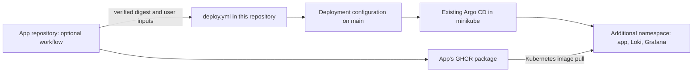

# ARGO-CD-GitOPS-Deployments

Shared deployment configuration for applications built in their own repositories.
An app's optional workflow publishes its image to its GHCR package and sends the
image digest and deployment inputs here. This repository records the desired
state; the existing Argo CD installation in minikube reconciles it.

Status: receiver and bootstrap tooling implemented; live dispatch, Argo sync,
browser access and Grafana verification are pending. No deployment result is
claimed by a successful configuration-commit job.



## Layout

| Path | Purpose |
|---|---|
| `.github/workflows/deploy.yml` | Receive a request, validate it, check the public image index and commit manifests |
| `.github/workflows/check.yml` | Run local tests on PRs and pushes to main |
| `projects/<project>.json` | Registered source repository, listener, health path and environment settings |
| `deployments/<project>/<namespace>/<deployment>/` | Generated `resources.json`, public `record.json` and `commands.txt` |
| `bootstrap/<deployment-id>.json` | Generated Namespace, restricted AppProject and Application |
| `scripts/render.py` | Input validation and deterministic manifest generation |
| `scripts/bootstrap.py` | Manual ownership checks and one-time cluster registration |
| `tests/` | Input, isolation, rollout and bootstrap regression tests |

The first registered project is `foundation`. Additional apps can register a
profile and use the same dispatch contract; they provide their own application
code, health endpoint and log instrumentation. Listener configuration in the
profile must match what that application's image actually supports.

## One-time repository setup

Merge these files into this repository's `main` branch. The receiving workflow
needs `contents: write` to commit generated configuration; repository rules must
allow that bot push, otherwise the job will fail rather than force-pushing.
This is a separate configuration repository and does not modify the app
repository's existing CI or manual-image deployment.

In the app repository, store `CD_DISPATCH_TOKEN` as an Actions secret. Its
fine-grained token grants **Actions: read and write** on this deployment
repository only. Publishing uses the app repository's own `GITHUB_TOKEN`.

The GHCR package must be public for this receiver's anonymous registry check
and minikube pulls. No kubeconfig, Kubernetes token or registry credential goes
into Git or this workflow.

## First deployment

1. Keep Docker Desktop and the existing minikube cluster running.
2. In the app repository, manually run its optional workflow. Select **Build
   image: No**, **Deploy: Yes**, and supply the full image digest reference from
   its successful publishing run's summary or `deployment-request.json` artifact.
3. Choose a new namespace and deployment name. Keep local ports `18090`, `3001`
   and `3101` only if those ports are available on your Mac.
4. Follow **Actions → Record deployment request** in this repository. The job
   validates the registered source, image reference, environment and destination,
   and confirms the registry index contains AMD64 and ARM64 manifests before
   committing configuration. It does not rerun the app's smoke checks or
   independently attest the caller's source-commit claim.
5. Pull this repository's updated `main` on the Mac and review the generated
   `resources.json`, `record.json` and `bootstrap/<deployment-id>.json` files.
6. Run the bootstrap command printed by the receiving job:

   ```bash
   python3 scripts/bootstrap.py <deployment-id>
   ```

   Replace `<deployment-id>` with the actual `cd-...` value from the job summary.
   The script explicitly targets context `minikube`, checks ownership of the
   namespace, AppProject, Application and app/observation resources, then applies
   only the generated bootstrap file. It never reinstalls Argo or runs the old
   project's setup script.

7. Use the generated `commands.txt` to check the Application, Pods, Services and
   EndpointSlices, then run each port-forward in a separate terminal. Wait for
   Argo **Synced/Healthy** and the new Pods to become ready before browsing.
8. Open the app at its selected local port and Grafana at its selected local
   Grafana port, dashboard `/d/cd-requests`. Match a new browser request ID to its
   Loki row before recording deployment success.

For a later image update, keep the same namespace and deployment name and run
the app's optional workflow again. Once the Application exists, Argo syncs new
commits automatically; the first-deployment bootstrap is not repeated for every
image update.

## Separation and ports

Each installation has its own namespace, Argo Application and AppProject. The
AppProject allows only this repository and that namespace, denies cluster-scoped
resources, and permits the required namespaced resources. Argo watches only
`resources.json`; the deployment record and command file are not Kubernetes
resources.

Original namespaces `p1-islandawolfe-02`, `observability`, `argocd`, `default` and
`kube-*` are rejected. Generated manifests never point at those application
resources; only the new AppProject/Application objects are created in `argocd`.
Automatic pruning is disabled and shared Argo resources cause sync failure.
Existing live resources without the matching deployment ownership label cause
bootstrap to stop before applying anything.

| Component | Listener/Service port | Default Mac port-forward port |
|---|---|---|
| Foundation app | `8081` | `18090` |
| New Grafana | `3001` | `3001` |
| New Loki HTTP | `3101` | `3101` |
| New Loki gRPC | `9096` (internal listener only) | none |

Local ports are user inputs and must differ between recorded installations.
Original ports `18080`, `18081`, `18082`, `3000` and `3100` are reserved. The
receiver cannot inspect which ports other processes occupy on the Mac; check
that locally. Identical container ports in separate Pods/namespaces do not bind
the same Mac port.

The app pushes logs through the new namespace's Loki Service. Its session label
is the stable deployment ID. Grafana's datasource points to that Loki, and its
dashboard filters that session. Each installation has separate observation
Pods; their memory use is additional, and this small Loki setup is ephemeral.
Save observations before restarting its Pod.

## Review and recovery

The receiver commits configuration directly to `main` after its checks pass.
Bot pushes do not trigger another Actions push run, so the receiver's own checks
are required before committing; Argo observes the Git commit independently.
Do not treat a configuration commit as proof of a healthy rollout.

For recovery, dispatch the previously verified image digest for the same
installation. Revert public configuration changes through a reviewed PR when
needed; the app ConfigMap hash changes its Pod template and causes a rollout.
Changing a namespace or deployment name creates another installation and does
not remove the previous one. Deleting records does not clean up cluster
resources because pruning is disabled; removal is a separate manual task.

## Local checks

Python 3 and its standard library are sufficient:

```bash
PYTHONDONTWRITEBYTECODE=1 python3 -m unittest discover -s tests -v
```

References: [Argo directory sources](https://argo-cd.readthedocs.io/en/stable/user-guide/directory/),
[AppProjects](https://argo-cd.readthedocs.io/en/stable/user-guide/projects/),
[automated sync](https://argo-cd.readthedocs.io/en/stable/user-guide/auto_sync/),
[Loki configuration](https://grafana.com/docs/loki/latest/configure/),
[Grafana configuration](https://grafana.com/docs/grafana/latest/setup-grafana/configure-grafana/).
