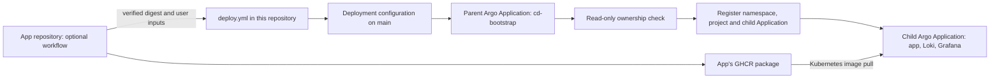

# ARGO-CD-GitOPS-Deployments

Shared deployment configuration for applications built in their own repositories.
An app's optional workflow publishes its image to its GHCR package and sends the
image digest and deployment inputs here. This repository records the desired
state; the existing Argo CD installation in minikube reconciles it.

Status: the existing manual registration route has a successful receiver run
and the owner reported `demo-app` Synced/Healthy with three ready Pods. Parent
automation is implemented locally; its first live installation and new-namespace
registration are pending. Browser/Grafana verification has not been recorded.



## Layout

| Path | Purpose |
|---|---|
| `.github/workflows/deploy.yml` | Receive a request, validate it, check the public image index and commit manifests |
| `.github/workflows/check.yml` | Run local tests on PRs and pushes to main |
| `projects/<project>.json` | Registered source repository, listener, health path and environment settings |
| `deployments/<project>/<namespace>/<deployment>/` | Generated `resources.json`, public `record.json` and `commands.txt` |
| `bootstrap/<deployment-id>.json` | Generated ownership hook, Namespace, restricted AppProject and Application |
| `scripts/render.py` | Input validation and deterministic manifest generation |
| `scripts/parent.py` | Preview or install the parent Application and read-only guard once per cluster |
| `scripts/guard.py`, `scripts/ownership.py` | Ownership checks used before automatic registration |
| `scripts/bootstrap.py` | Manual per-installation fallback using the same ownership rules |
| `tests/` | Input, isolation, rollout and bootstrap regression tests |

The first registered project is `foundation`. Additional apps can register a
profile and use the same dispatch contract; they provide their own application
code, health endpoint and log instrumentation. Listener configuration in the
profile must match what that application's image actually supports.

## One-time repository setup

Merge these files into this repository's `main` branch. The receiving workflow
needs `contents: write` to commit generated configuration; repository rules must
allow that bot push, otherwise the job will fail rather than force-pushing.
This is a separate configuration repository and does not modify the app
repository's existing CI or manual-image deployment.

In the app repository, store `CD_DISPATCH_TOKEN` as an Actions secret. Its
fine-grained token grants **Actions: read and write** on this deployment
repository only. Publishing uses the app repository's own `GITHUB_TOKEN`.

The GHCR package must be public for this receiver's anonymous registry check
and minikube pulls. No kubeconfig, Kubernetes token or registry credential goes
into Git or this workflow. No changes to the app repository are needed for
parent automation; the existing dispatch inputs stay the same.

## Install the parent once per cluster

After merging this feature into `main`, update your local deployment repository.
Keep Docker Desktop and the existing minikube cluster running. From this
repository, preview the configuration without contacting Kubernetes:

```bash
python3 scripts/parent.py > /tmp/argo-cd-parent.json
cat /tmp/argo-cd-parent.json
```

Review the parent AppProject, Application, guard service account, read-only
ClusterRole/binding and guard-code ConfigMap. Then install them:

```bash
python3 scripts/parent.py --install
kubectl --context minikube -n argocd get application cd-bootstrap
```

The installer preflights every seed object before applying any of them and
refuses to overwrite an existing object without this parent's ownership label.
It explicitly uses context `minikube`. It does not reinstall Argo or modify the
original project.

The parent watches only `bootstrap/cd-*.json` on this repository's `main`
branch. For every registration, Argo runs a read-only `PreSync` Job first; a
failed ownership check stops that parent sync. Successful checks are followed
by Namespace, AppProject and Application creation in that order. The child
Application then deploys the app, Loki and Grafana from `resources.json`.

Existing owned installations, including `demo-app`, keep their deployment IDs,
namespaces, application manifests and ports. Installing the parent adds its
tracking and ownership hooks; it does not rebuild or replace their images.
Do not move an existing installation's record to a different namespace to
enable automation.

The guard uses a digest-pinned, multi-platform Python image and the shared
ownership rules. Its account can only `get` the required resources; it cannot
write resources or read Secrets. The parent controller has the required write
permissions through Argo, while its AppProject permits only Namespaces and
the Application/AppProject/Job resources needed for registration in `argocd`.

This parent can create Argo Applications and Projects, so write access to this
repository is administrative. Keep it restricted to trusted maintainers. Run
the installer again when upgrading the installed guard Python code or its
read-only RBAC; those seed objects intentionally live outside the watched
bootstrap directory.

## Deploy or update an application

1. In the app repository, manually run its optional workflow. Select **Build
   image: No**, **Deploy: Yes**, and supply the full image digest reference from
   its successful publishing run's summary or `deployment-request.json` artifact.
   Select **Build image: Yes** when you want to publish and deploy a new build.
2. Choose a new namespace and deployment name for a new installation, or keep
   the existing values to update one. Keep local ports `18090`, `3001`
   and `3101` only if those ports are available on your Mac.
   Both names must be 1–63 characters, use only lowercase letters (`a-z`),
   digits (`0-9`) and hyphens (`-`), and start and end with a letter or digit.
   For example, use `demo-1`; `demo_1`, uppercase letters and spaces are not accepted.
3. Follow **Actions → Record deployment request** in this repository. The job
   validates the registered source, image reference, environment and destination,
   and confirms the registry index contains AMD64 and ARM64 manifests before
   committing configuration. It does not rerun the app's smoke checks or
   independently attest the caller's source-commit claim.
4. The parent detects the new Git state and automatically registers the
   installation after ownership checks. No per-installation apply or local Git
   pull is needed. The job summary shows the deployment ID and access commands.
5. Use the generated `commands.txt` to check the parent/child Applications,
   Pods, Services and EndpointSlices, then run each port-forward in a separate terminal. Wait for
   Argo **Synced/Healthy** and the new Pods to become ready before browsing.
6. Open the app at its selected local port and Grafana at its selected local
   Grafana port, dashboard `/d/cd-requests`. Match a new browser request ID to its
   Loki row before recording deployment success.

Both parent and child automatic sync keep pruning disabled. A successful parent
sync confirms registration, not that the child rollout or browser request has
passed; verify the child Application separately.

GitHub queue delays can still delay the configuration commit. If your Mac or
minikube is stopped or asleep, Argo resumes reconciliation when the cluster is
available again. Browser access still needs local port-forwards; the deployment
itself does not need them.

## Verify the first automatic registration

Test alongside the existing `demo-app` installation using a different namespace,
such as `demo-auto`, and unused local ports such as app `18091`, Grafana `3002`
and Loki `3102`. These are example inputs, not a required namespace.

After the receiver succeeds, use its printed commands to check the new child
Application and Pods. No per-installation bootstrap command should be needed.
Verify a browser board request and its matching Grafana row, then confirm the
original workloads and `demo-app` are still ready:

```bash
kubectl --context minikube -n p1-islandawolfe-02 get pods
kubectl --context minikube -n observability get pods
kubectl --context minikube -n demo-app get pods
```

Record the actual run, deployment ID and observations after the test; the local
unit tests do not count as that live verification.

## Manual fallback

The previous route remains available when the parent is not installed:

```bash
python3 scripts/bootstrap.py <deployment-id>
```

Use the actual ID from the receiving workflow. This command checks ownership
directly and applies only the Namespace, AppProject and child Application;
it skips the Argo-only hook Job. Do not use it to bypass an ownership failure.

## Separation and ports

Each installation has its own namespace, child Argo Application and AppProject.
The child AppProject allows only this repository and that namespace, denies
cluster-scoped resources, and permits the required namespaced resources. The child watches only
`resources.json`; the deployment record and command file are not Kubernetes
resources.

Original namespaces `p1-islandawolfe-02`, `observability`, `argocd`, `default` and
`kube-*` are rejected as application destinations. Registration and guard
objects are created in `argocd`; the original app and observation resources
are not included in the generated desired state.
Automatic pruning is disabled and shared Argo resources cause sync failure.
Existing live resources without the matching deployment ownership label cause
the manual preflight or automatic guard to fail. The guard checks the namespace,
AppProject, Application and generated app/observation resources before parent
registration. These checks are not an admission policy against other cluster
administrators making concurrent changes.

| Component | Listener/Service port | Default Mac port-forward port |
|---|---|---|
| Foundation app | `8081` | `18090` |
| New Grafana | `3001` | `3001` |
| New Loki HTTP | `3101` | `3101` |
| New Loki gRPC | `9096` (internal listener only) | none |

Local ports are user inputs and must differ between recorded installations.
Original ports `18080`, `18081`, `18082`, `3000` and `3100` are reserved. The
receiver cannot inspect which ports other processes occupy on the Mac; check
that locally. Identical container ports in separate Pods/namespaces do not bind
the same Mac port.

The app pushes logs through the new namespace's Loki Service. Its session label
is the stable deployment ID. Grafana's datasource points to that Loki, and its
dashboard filters that session. Each installation has separate observation
Pods; their memory use is additional, and this small Loki setup is ephemeral.
Save observations before restarting its Pod.

## Review and recovery

The receiver commits configuration directly to `main` after its checks pass.
Bot pushes do not trigger another Actions push run, so the receiver's own checks
are required before committing; Argo observes the Git commit independently.
Do not treat a configuration commit as proof of a healthy rollout.

For recovery, dispatch the previously verified image digest for the same
installation. Revert public configuration changes through a reviewed PR when
needed; the app ConfigMap hash changes its Pod template and causes a rollout.
Changing a namespace or deployment name creates another installation and does
not remove the previous one. Deleting records does not clean up cluster
resources because pruning is disabled; removal is a separate manual task.

If parent registration fails, inspect the parent and its ownership-check Jobs:

```bash
kubectl --context minikube -n argocd get application cd-bootstrap
kubectl --context minikube -n argocd get jobs
kubectl --context minikube -n argocd logs job/<failed-job-name>
```

Successful guard Jobs are removed by Argo; failed Jobs remain for diagnosis.
Retries use unique Job names and do not delete unrelated Jobs. Correct the
ownership conflict or RBAC/registry problem, then retry a full parent sync or
publish a corrected configuration commit. Selective sync skips hooks, so use
full parent syncs. Repeated failures stop after the configured retry limit.

## Local checks

Python 3 and its standard library are sufficient:

```bash
PYTHONDONTWRITEBYTECODE=1 python3 -m unittest discover -s tests -v
```

The tests cover the manual fallback, ownership refusal, API failures, restricted
guard permissions, sync ordering and parent installation. They mock Kubernetes
calls and do not prove a live parent rollout. The existing app publishing and
deployment-request workflows require no changes.

References: [Argo directory sources](https://argo-cd.readthedocs.io/en/stable/user-guide/directory/),
[AppProjects](https://argo-cd.readthedocs.io/en/stable/user-guide/projects/),
[automated sync](https://argo-cd.readthedocs.io/en/stable/user-guide/auto_sync/),
[sync phases and waves](https://argo-cd.readthedocs.io/en/stable/user-guide/sync-waves/),
[Loki configuration](https://grafana.com/docs/loki/latest/configure/),
[Grafana configuration](https://grafana.com/docs/grafana/latest/setup-grafana/configure-grafana/).
